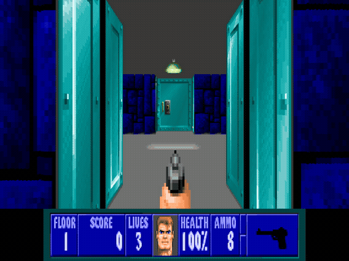
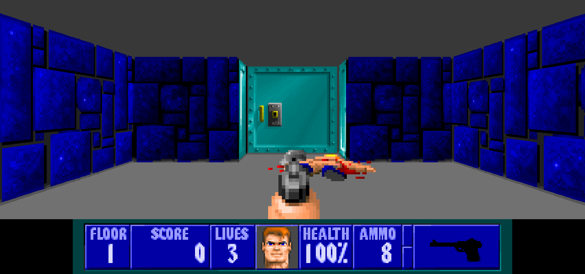
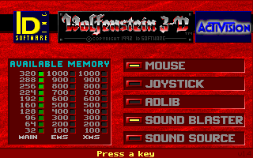
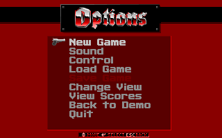
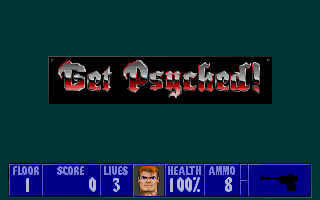

<div align="center">

# Wolfenstein 3-D, recompiled and redrawn

**Wolfenstein 3-D** (1992, id Software): taken apart from its shipping DOS
executable and rebuilt as a native Windows program, with its 3D view redrawn
at high resolution and widened to 16:9 from the game's own art. No DOSBox, no
emulator, no source port.



<sub>E1M1, recompiled and redrawn at 1704×800. Through two doors and into a guard,
who opens fire. Recorded headless with the built-in recorder.</sub>

</div>

---

## What it is

A static recompilation of Wolfenstein 3-D v1.4. `tools/lift.py` unpacks
`WOLF3D.EXE`, finds every function in it and lifts the 16-bit x86 to C with the
[pcrecomp](https://github.com/sp00nznet/pcrecomp) toolkit. A small DOS machine in
`src/` answers the DOS, VGA, Sound Blaster, AdLib, keyboard and timer the game
expects. On top of the unchanged game sits a remaster: the 3D view is redrawn
at up to 6× from the game's own textures and sprites, and widened by casting
extra rays with the game's own raycaster. You supply the game; the build
produces `wolf3d_wl6.exe`.

It is part of the pcrecomp family and follows its house style (repo rules,
section 10): the toolkit ships, the output never does. The DOS machine comes
from the [Blake Stone recomp](https://github.com/sp00nznet/blakestone), whose
engine is Wolfenstein's, and the presenter from Gunman and Red Alert 2.

## Status

**v0.1.0, alpha.** The game boots, plays, saves and loads, and passes its
conformance run.

| | |
|---|---|
| Version recompiled | v1.4 (Activision, the Steam and GOG release) |
| Functions lifted | 747, plus the compiled scalers interpreted at run time |
| Signon, PG-13, title, menus, episode and difficulty select | ✅ |
| E1M1: 3D view, HUD, movement, doors, combat | ✅ |
| AdLib music and FM effects (ymfm OPL2) | ✅ |
| Sound Blaster digitized sound (DMA + IRQ) | ✅ |
| Saving and loading | ✅ |
| Hi-res 3D view: walls, doors, actors, objects, the weapon (`--hires 1`–`6`) | ✅ |
| Widescreen 16:9 / 21:9 (the game's own raycaster, turned) | ✅, at the full view size |
| NVIDIA DLSS / DLAA on the 3D view (optional download, RTX GPU) | ✅ |
| Direct3D 11 presenter: sharp-bilinear, smooth, CRT, nearest, integer | ✅ |
| Borderless fullscreen, settings kept in `wolf3d.ini` | ✅ |
| Headless recording (`--headless --record out.mp4`) | ✅ |
| Mouse (raw input) | implemented, untested |
| Gamepad (XInput, as keys) | implemented, untested |
| PC speaker | modelled, untested |
| Episodes 2–6, a full playthrough | not yet tried |
| **Conformance** ([docs](docs/conformance.md)) | **17/17**, 18/18 with DLSS |

Everything marked ✅ was seen working, in scripted headless runs (which the
conformance harness repeats) and in a window on a virtual monitor. Nobody has
yet played it end to end with hands on a keyboard. Treat it as an alpha.

## The remaster: redrawn, not upscaled



The 3D view is not the 320×200 picture enlarged. Every frame, the original
raycaster runs exactly as it shipped, and the renderer listens to its answers:
which texture and column each ray hit, how tall the wall is there, exactly
where the ray landed in the texel, and which sprite went where at what height.
Then it draws the frame again at the output resolution from the game's own
64×64 art. Walls come out as straight edges instead of staircases, texels are
sampled where the ray actually landed, and sprites are drawn from their own
posts at a fitted centre.


For 16:9 the game's own WallRefresh and DrawScaleds run twice more each frame,
turned left and right about the eye. Every byte of guest memory is put back
afterwards, so the game can't tell; the conformance harness checks that the
4:3 middle is pixel-identical.

**DLSS, optional.** With an RTX GPU and NVIDIA's SDK fetched by
`py tools\get_dlss.py` (or Setup), the redrawn view goes through DLSS: DLAA by
default, or Super Resolution from fewer pixels. The raycaster knows exactly
where every pixel was last frame, so DLSS gets exact depth and motion vectors.
The SDK is NVIDIA's and is never in this repository:
[docs/dlss.md](docs/dlss.md).


<sub>The left wall's top edge: DLSS off, DLAA, quality (from 1136×427), performance (from 852×320).</sub>

Wolf3D draws its walls and sprites with **compiled scalers**, code it writes
into memory at start-up. They can't be lifted, so the runtime interprets them.
How the renderer works, and why it asks the original raycaster rather than
replacing it: [docs/renderer.md](docs/renderer.md).

| Key | |
|---|---|
| **F10** | widescreen → original → hi-res 4:3 |
| **F11**, **Alt+Enter** | borderless fullscreen |
| **F12** | scaling: sharp-bilinear → smooth → CRT → nearest → integer |
| **F9** | colour: natural / vivid |
| **F8** | DLSS: off → DLAA → quality → balanced → performance (when available) |
| **Ctrl+F12** | screenshot to `screenshots\` |

Widescreen needs the largest view size (Options → Change View, all the way
up). Steam's CONFIG ships one size smaller, which keeps the border.

## Screenshots

Every one of these is the recompiled game running.

| | |
|---|---|
|  |  |
| The signon screen | The menus |
|  |  |
| "How tough are you?" | E1M1 at 16:9 |

## The game

**Wolfenstein 3-D** puts you in the boots of B.J. Blazkowicz, an Allied spy
captured and held in Castle Wolfenstein, who escapes with a knife and a
pistol taken from a guard. The original six episodes take him out of the
castle, through Operation Eisenfaust's mutant experiments, to Hitler's bunker
and beyond. Each episode is ten floors, nine plus a secret one, with a boss
at the end. id Software released it on 5 May 1992 as shareware through Apogee:
the first episode free, the other two of the original trilogy by mail order,
and *The Nocturnal Missions* (episodes 4–6) soon after.
[[Wikipedia]](https://en.wikipedia.org/wiki/Wolfenstein_3D)

### Where it came from

It was a remake of Muse Software's *Castle Wolfenstein* (1981), made by
John Carmack, John Romero, Tom Hall and Adrian Carmack, the team that had
left Softdisk to form id. Its raycasting engine grew out of *Hovertank 3D* and
*Catacomb 3-D*, and its texture-mapped walls at full speed on a 286 are why it
is called the grandfather of the first-person shooter. Bobby Prince wrote the
music. The engine was licensed widely; JAM Productions' *Blake Stone*, the
sibling recomp of this project, is built on it.
[[Wikipedia]](https://en.wikipedia.org/wiki/Wolfenstein_3D)

id released the source code in 1995, later under the GPL, and source ports
built on it (ECWolf, Wolf4SDL) are the usual way to play it with modern
features. This project goes the other way and uses none of that code: it
starts from the executable you own, and keeps exactly the machine code that
shipped. Everything the runtime knows about the game was read out of that
executable with pcrecomp's disassembler.

## Getting Started

You need your own copy of the game. The Steam and GOG releases (v1.4) work.
Other versions are untested.

### Quick start

1. Download this repository (Code → Download ZIP) and unzip it anywhere.
2. Double-click **`Setup.cmd`**.

Setup checks for Python 3, CMake, Visual Studio 2022's C++ build tools and Git,
and **asks** before installing any that are missing (it says what, why and how
big). It then:

1. finds the game in your Steam libraries (or GOG's default folder, or asks you);
2. copies the game's own files (`WOLF3D.EXE` and the `.WL6` data) into `original\wl6`;
3. fetches pcrecomp next to this folder;
4. lifts and builds the game;
5. leaves a **Wolfenstein 3-D** shortcut here.

On a PC with an NVIDIA GPU it also offers the optional DLSS SDK, which is
NVIDIA's, under NVIDIA's licence, and only downloaded if you say yes
(`Setup.cmd -Dlss` says yes for you).

If anything fails it stops with one sentence on what to do and writes the
details to `setup.log`. Running it again carries on from where it stopped.

### Step by step

Prerequisites: Windows 10/11 x64, Python 3.10+ (`py --version`), CMake 3.20+,
Visual Studio 2022 with the *Desktop development with C++* workload (Build Tools
is enough), Git. ffmpeg is optional (only `--record` needs it).

1. **Get the toolkit**, next to this folder:

   ```powershell
   git clone https://github.com/sp00nznet/pcrecomp ..\pcrecomp
   git -C ..\pcrecomp checkout 61edd49
   $env:PCRECOMP_HOME = (Resolve-Path ..\pcrecomp)
   ```

2. **Copy your game files** into `original\wl6`: the `base` folder of Steam's
   copy, not the DOSBox folder beside it.

   ```powershell
   $s = "C:\Program Files (x86)\Steam\steamapps\common\Wolfenstein 3D\base"   # or your library
   mkdir original\wl6
   copy "$s\*.WL6" original\wl6
   copy "$s\WOLF3D.EXE" original\wl6
   ```

3. **Lift** the executable to C:

   ```
   > py tools\lift.py wl6
   WOLF3D.EXE: DGROUP 398D, 29 code segments, 747 functions, 48334 instructions lifted, 237 stored code pointers, 0 extra entries, 51 switch tables
     1 undecodable targets, first: 2005:25D7 (in fn_221A2)
     widescreen: pixelangle=960E midangle=D9C8 player=95BC p_angle=002A p_x=0010 p_y=0014 focal=989A
     renderer: yint=D9A2 xint=D9A6 pixx=D9B2 wallheight=504A postseg=D85A postoff=D858 sl_seg=DDED sl_cmd=DDEB sl_x=DDF1 sl_w=DDEF bufofs=52D4
     20 self-modified code bytes
     1 far calls into nothing (stubbed as dispatch)
     unhandled instruction forms: 1 (1 kinds), first: ['? di']
     -> work\wl6\gen (5 files, 8 changed)
   ```

   The undecodable target and the `? di` are bytes the CPU never executes (a
   Borland RTL routine that jumps into its own instructions); they are
   expected. The `renderer:` and `widescreen:` lines are the remaster's hooks,
   found in the code.

4. **Build** (a few minutes; the lifted C is large):

   ```powershell
   cmake -B build -G "Visual Studio 17 2022" -A x64 -DPCRECOMP_HOME=$env:PCRECOMP_HOME
   cmake --build build --config Release -- -m
   ```

   Expect `build\Release\wolf3d_wl6.exe`.

5. **Play** from this folder. The game looks for `original\wl6`, and keeps
   CONFIG and saved games in `saves\wl6`:

   ```powershell
   build\Release\wolf3d_wl6.exe
   ```

**Usual trip-ups.**

- **`python` opens the Microsoft Store.** The Store alias is in the way: use
  `py`, or turn the alias off in *Settings → Apps → Advanced app settings →
  App execution aliases*.
- **A tool you just installed isn't found.** It isn't on `PATH` until you open
  a new terminal.
- **`cannot find the pcrecomp toolkit`.** `PCRECOMP_HOME` is unset in this
  terminal.
- **Moving.** Steam's CONFIG moves with **W/A/S/D**, not the arrows; the arrows
  drive the menus.

## Usage

```
wolf3d_wl6.exe [options] [-- game arguments]
```

| Option | |
|---|---|
| `--fullscreen` | start in borderless fullscreen; **F11** / **Alt+Enter** toggle |
| `--window N` | window size in multiples of 320×240 (default 3) |
| `--scale MODE` | `sharp` (default), `smooth`, `crt`, `nearest`, `integer`; **F12** cycles |
| `--hires N` | hi-res 3D view at N × 320×200 (default 4 in a window, off headless) |
| `--widescreen A` | widen the hi-res view to `16:9` (default in a window), `21:9`, or `off` (default headless). **F10** cycles widescreen → original → hi-res 4:3 |
| `--dlss MODE` | `off`, `dlaa`, `quality`, `balanced`, `performance`, `ultra`: the 3D view through NVIDIA DLSS (needs the optional SDK and an RTX GPU; default `dlaa` in a window when available) |
| `--gdi` | present through GDI instead of Direct3D 11 |
| `--mute` | no sound |
| `--data DIR` / `--save DIR` | game files / where CONFIG and saved games go |
| `--headless` | no window and no audio device (works over RDP and in CI); time is deterministic, so runs are reproducible and faster than real time |
| `--realtime` | with `--headless`: run on the wall clock instead |
| `--record out.mp4` | record video and audio (needs ffmpeg) |
| `--seconds N` | quit after N seconds |
| `--keys "ms:KEY,..."` | scripted input, e.g. `--keys "4000:ENTER,9000:ENTER,23000:W+2000"` |
| `--route "ms;go X,Y;use;..."` | test autopilot: walk the player to waypoints |
| `--shot-at "ms:file.bmp,..."`, `--shot file.bmp`, `--wav out.wav` | frames and audio for testing |
| `--trace` | log DOS calls and Sound Blaster commands to stderr |

In the window:

- **Mouse:** click to capture it; it's released when the window loses focus.
  Turn the mouse on in the game's *Control* menu.
- **Gamepad:** an Xbox-style pad works as the keys the game already uses.
  Stick or d-pad moves (in menus and in play), **RT** fires, **LT** strafes,
  **A** uses, **X** is Enter, **RB** runs, **B**/**Start** is Esc, **Back** is Tab.
- **Quit:** **Alt+F4**.

The presenter remembers its scaling, colour look, fullscreen and F10 choice in
`build\Release\wolf3d.ini`; the command line wins over the file.

A minute of the game at 16:9, with no window at all:

```powershell
build\Release\wolf3d_wl6.exe --headless --hires 4 --widescreen 16:9 --seconds 60 --record wolf.mp4 --keys "4000:ENTER,9000:ENTER,13000:ENTER,15000:ENTER,17000:ENTER,19000:ENTER,23000:W+1100,24300:SPACE,25500:W+2600"
```

(Widescreen needs the full view size in the save folder's CONFIG; see
[docs/conformance.md](docs/conformance.md#the-scripts).)

## Building from source

The lifted C is **not** in this repository. It is a machine translation of the
game's own code, so it is not redistributable: you generate it from your copy,
the same way you supply the game data. `original\`, `work\` (the unpacked image
and the lifted C) and `saves\` are all gitignored.

- `tools/lift.py`: the lift driver, and the finder that reads the renderer's
  hooks out of the code. Needs pcrecomp (`PCRECOMP_HOME`, or a `..\pcrecomp`
  checkout). Re-run it after changing it or the toolkit.
- `src/`: the DOS machine the lifted code runs on, the renderer and the
  presenter. See [docs/architecture.md](docs/architecture.md).
- `py tools\conformance.py`: the conformance harness.
  `build\Release\selftest.exe`: the hardware models without game data. See
  [docs/conformance.md](docs/conformance.md).
- `cmake -B build-trace -DWOLF_TRACE=ON`: a build that records lifted calls,
  for `WOLF_CALLS` and `WOLF_WATCH`; see
  [docs/lifting.md](docs/lifting.md#debugging-kit).

- `py tools\get_dlss.py`: the optional NVIDIA DLSS SDK into `external\dlss-sdk`
  (NVIDIA's licence; gitignored). Re-run cmake after it. See
  [docs/dlss.md](docs/dlss.md).

**Toolkit version.** Setup and CI build against pcrecomp commit `61edd49`
(`main`, 2026-10-10), the one conformance last ran against. No toolkit change
was needed for this game; the run-time scaler interpreter lives in this repo's
runtime, as the DOS machine does.

## Documentation

| Page | What is in it |
|------|---------------|
| [architecture](docs/architecture.md) | The parts, memory map, how time and interrupts work, code the game writes at run time, the presenter |
| [lifting](docs/lifting.md) | What Wolf3D needed beyond Blake Stone: the page-flip wait, compiled scalers, the CONFIG's keys |
| [renderer](docs/renderer.md) | The hi-res and widescreen 3D view: asking the original raycaster, compositing by who drew each pixel |
| [dlss](docs/dlss.md) | The optional DLSS path: what it is given, how the conventions were measured, the licence |
| [conformance](docs/conformance.md) | What the harness checks and why that is the ground truth |
| [ROADMAP](ROADMAP.md) | What's next |

## License

The code in this repository (the lift driver, the runtime, the scripts and the
documentation) is MIT licensed ([LICENSE](LICENSE)). `third_party/ymfm` is
Aaron Giles' ymfm under the BSD 3-Clause licence ([NOTICE](NOTICE)).

That covers this project's own work and nothing else. **Wolfenstein 3-D is not
included and is not licensed here.** No game executable, data, art, audio or
manual is in this repository, and nothing generated from the executable is
either. The screenshots and the GIF above are captures of the game running, to
show what the project does; the pictures in them belong to their owners. This
project is unaffiliated with id Software, Activision, Bethesda or ZeniMax, and
uses none of the Wolfenstein 3-D source release. NVIDIA DLSS is NVIDIA's,
under its own licence; it is not in this repository and is downloaded only
by you, for your build.
