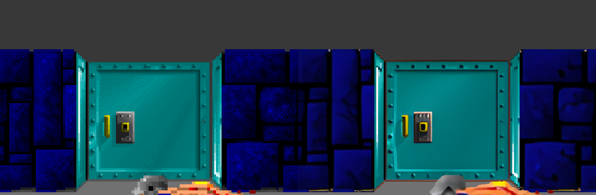
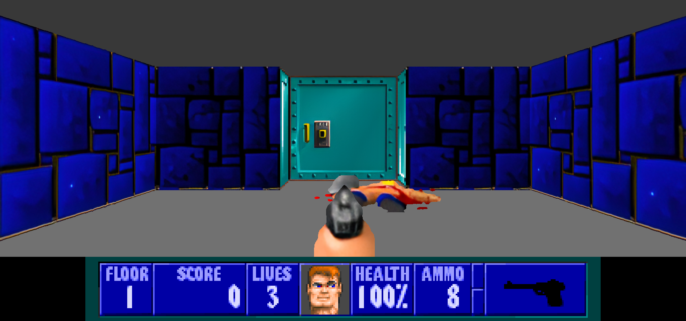

# The upscaled art

DLSS reconstructs what the game draws, and Wolfenstein 3-D draws 64×64
textures. For a visible step up close, the art itself is redrawn: every wall
and sprite page goes through a neural upscaler at 4× (256×256), once, on your
machine, and the hi-res renderer draws from that instead.



*The same frame at 4×: the game's own 64×64 art (left), and the upscaled art
(right). The door's bevels and lock, the stone's cracks, and the corpse's
outline.*



| | |
|---|---|
| `py tools\upscale_art.py` | makes it (about 30 s on a GPU); Setup offers it, `Setup.cmd -Art` says yes |
| **F6**, `--art on\|off` | use it or the game's own art (default on when it exists); kept in `wolf3d.ini` |

Code: [`tools/upscale_art.py`](../tools/upscale_art.py) makes it; `art_*` in
[`src/hires.c`](../src/hires.c) draws from it.

## Making it

```
> py tools\upscale_art.py
fetching the upscaler (Real-ESRGAN ncnn/Vulkan, MIT, ~45 MB) into G:\recomp\pc\wolfdlss\external\realesrgan
106 walls, 436 sprites -> realesrgan-x4plus x4
-> G:\recomp\pc\wolfdlss\work\wl6\art\art.bin (135 MB); upscaled PNGs kept in G:\recomp\pc\wolfdlss\work\wl6\art\out to look at
```

1. **The pages** come out of your own `original\wl6\VSWAP.WL6`, read as the
   modding wiki documents the page file: a header with the page count and
   where sprites start, then offsets and lengths. Walls are 64×64 palette
   indices stored a column at a time. Sprites are `t_compshape`: left and right
   columns, then a list of posts per column (end, source, start), the same
   structure the renderer already walks.
2. **The palette** is read from the unpacked executable (`work\wl6\unpacked.exe`),
   found by its first eight entries, the EGA colours every id VGA palette
   starts with.
3. **Walls are upscaled tiled 3×3**, and the middle third is kept. Walls
   repeat, and an upscaler shown one tile invents edges at its borders; the
   middle of the 3×3 wraps without a seam.
4. **Sprites are upscaled twice.** The colours go in with the transparent area
   filled from the nearest opaque texel, so no black fringe bleeds into the
   edges; the coverage mask goes in as black and white, and comes back as a
   smooth silhouette rather than enlarged stair steps.
5. **Everything is packed** into `work\wl6\art\art.bin`: the palette, then each
   page's kind, a hash of its contents, and 256×256 RGBA. `work\` is
   gitignored: this is derived from the game's data and never committed.

The upscaler is [Real-ESRGAN](https://github.com/xinntao/Real-ESRGAN)
(BSD-3-Clause) in its portable
[ncnn/Vulkan build](https://github.com/xinntao/Real-ESRGAN-ncnn-vulkan) (MIT),
downloaded into the gitignored `external\realesrgan\`. It runs on any Vulkan
GPU and needs no Python packages. `--model anime` picks
`realesrgan-x4plus-anime` instead of the default `realesrgan-x4plus`. Tried
side by side on the walls, the anime model flattened the stone's grain and
washed the purple organic wall out entirely; x4plus kept both.

## Drawing from it

The page cache moves pages around guest memory, so a page's address says
nothing. Its contents do. Each frame, each texture segment the raycaster and
the sprite scaler use is hashed (FNV-1a), in the same way `upscale_art.py`
hashed the VSWAP page: all 4096 bytes of a wall; a sprite's header, its post
commands and the pixels they use. The hash is looked up in the pack. No
address, no table per version.

Walls are sampled at the exact texel position the redraw already computes
(the game's column, plus where in it the ray landed, and the continuous row),
bilinearly from the 256×256 art. Sprites are sampled the same way, and their
coverage comes from the upscaled mask (drawn where it is over half) instead of
the posts. Occlusion, the weapon and the widescreen strips work as before.
The DLSS path draws from the same art.

**Palette effects.** The art is RGB, but the game tints its palette: the red
damage flash, the gold bonus flash, fades to black. Every frame the live
palette is fitted against the palette the art was made from, per channel, as
*c′ = a·c + b* (least squares over the 256 entries), and applied to the art.
A flash toward a colour and a fade to black are both exactly that form, so
the art flashes and fades with everything else.

## Cost

Per composed frame at 1704×640 on an RTX 5070 (`--trace`): 4.6 ms with the
art, 7.8 ms with the art through DLSS quality. 135 MB of RAM for the pack.

## Conformance

When `work\wl6\art\art.bin` exists, `tools/conformance.py` checks that the
hi-res frame differs from the same frame with `--art off` (54% of view pixels
when last run) and that the HUD below it is identical. Without the pack it
prints `SKIP`, uncounted.
