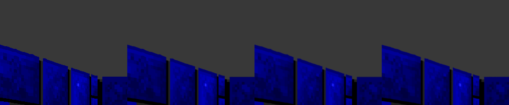

# DLSS

With an RTX GPU, the hi-res 3D view can go through NVIDIA DLSS: DLAA
(anti-aliasing at the output size, the default when it's available) or Super
Resolution, which renders fewer pixels and reconstructs the rest.



*The far end of a corridor in the game's attract demo, the player walking,
enlarged 3×: DLSS off (left), DLAA (right). Off, the near pillar's texture is
squeezed below a pixel per texel and comes out as speckle that crawls as you
move; DLAA resolves it into stone. Close up, the two look alike: the art is
64×64, and DLSS reconstructs what the game draws, it does not add detail.*

**For detail up close, add the upscaled art** ([art.md](art.md)): DLSS then
reconstructs from 256x256 textures instead of 64x64.

**What to expect.** The hi-res redraw already renders every frame at the
output resolution with exact geometry, so on near walls DLSS has little to
fix. It earns its keep at a distance and in motion: texture shimmer and crawl
on far walls, and the stair-stepped edges of walls and sprites, both of which
a still screenshot undersells.

| Key / option | |
|---|---|
| **F8** | off → DLAA → quality → balanced → performance |
| `--dlss MODE` | `off`, `dlaa`, `quality`, `balanced`, `performance`, `ultra` (default `dlaa` in a window when available, `off` headless) |
| `wolf3d.ini` `[present] dlss=` | the last F8 choice |

Code: [`src/dlss.cpp`](../src/dlss.cpp) (the NGX calls) and `dlss_view()` in
[`src/hires.c`](../src/hires.c) (what DLSS is given).

## Optional, and not in this repository

DLSS is NVIDIA's SDK under the
[NVIDIA RTX SDKs licence](https://github.com/NVIDIA/DLSS/blob/v310.9.1/LICENSE.txt),
not MIT. That licence forbids using the SDK in a way that puts it under an
open-source licence, so none of it is in this repository: not the headers,
not the library, not the DLL. You fetch it for your own build:

```
> py tools\get_dlss.py
The NVIDIA DLSS SDK v310.9.1 is licensed by NVIDIA under the NVIDIA RTX SDKs licence:
  https://github.com/NVIDIA/DLSS/blob/v310.9.1/LICENSE.txt
It is downloaded for your own build only (about 65 MB) and is never part of this repository.
Have you read it, and do you accept it? [y/N] y
  LICENSE.txt
  include/nvsdk_ngx.h
  ...
  lib/nvsdk_ngx_s.lib
  bin/nvngx_dlss.dll
DLSS SDK v310.9.1 -> G:\recomp\pc\wolfdlss\external\dlss-sdk. Re-run cmake (or Setup) to build with DLSS.
```

`Setup.cmd` offers the same on a PC with an NVIDIA GPU (`Setup.cmd -Dlss`
accepts it without asking). `external/` is gitignored. With it present, CMake
says `wolf3d_wl6: with DLSS`, compiles `src/dlss.cpp`, links
`nvsdk_ngx_s.lib` and copies `nvngx_dlss.dll` next to the exe; without it, the
build is the same minus `--dlss`, which then says it isn't available.
`src/dlss.cpp` itself is this project's code, MIT like the rest.

The script downloads with `curl`, not Python's `urllib`: on this machine
`urllib` stalled for good 15 KB short of the end of the 59 MB DLL on every
try, while curl fetched it in seconds.

## What DLSS is given

DLSS doesn't upscale a picture; it accumulates many jittered frames, so it
needs to know where every pixel was in the previous frame. A raycaster can
answer that exactly, which is the whole reason this works well.

`dlss_view()` draws the view again from the same captured columns and sprites
as the hi-res compositor ([renderer.md](renderer.md)), at the size DLSS asks
for, and samples each pixel at its centre plus a jitter offset (a Halton 2,3
sequence, 8 to 64 phases depending on the scale). Alongside the colour:

- **Depth.** A wall or sprite with half-height *hh* on screen is *K / hh* tiles
  away, and a floor or ceiling pixel *dy* rows from the horizon is *K / dy*
  away. *K* is measured every frame from the raycaster's own hit points: the
  Hit routines leave the exact intercept, so distance along the view times
  *hh* gives it directly (about 109 at the full view size). Depth goes in as 1
  near, 0 far (`DepthInverted`).
- **Motion vectors.** Each pixel's world position, from its depth and its
  column's ray through the eye, projected through the *previous* frame's eye.
  That is exact for everything that doesn't move: walls, floor, ceiling,
  objects, corpses. Walking actors get the same, which is close.
- **A bias mask** over the weapon: it moves with the eye (no motion), and its
  animation frames aren't motion, so DLSS is told to trust the current frame
  there.

A reset is sent on the first frame, when the view's size or shape changes, and
on a jump (more than 2 tiles or 45° between frames: a new level, a load).

DLSS runs on a Direct3D 11 device of its own and the result is read back into
the frame, so the same path works in a window and headless (`--record`). In a
window every presented frame goes through it. Headless, only composed frames
do (a recording, or `--shot-at`), and a lone screenshot has no history.
Whatever the game drew over the view (text, the fizzle fade) is kept on top.

## How the conventions were checked

Two signs are easy to get backwards, and both were measured rather than
guessed:

- **Motion vectors point from the current frame to the previous.** With the
  previous render warped by the vectors, the mean difference from the current
  render was 2.5 while walking (10 with no motion, 20 with the vectors
  negated). While turning it was 21, against 65 and 80; the remainder is the
  strip of newly revealed columns at the view's edge.
- **The jitter offset goes to DLSS negated.** Sampling at centre + (jx, jy) and
  passing (jx, jy) left the DLSS output 40% further from the plain render
  (mean difference 4.6 against 2.7 over a walk and two turns).

## Cost

Per composed frame at 1704×640 (`--trace` prints it), on an RTX 5070:

| | ms |
|---|---|
| off (the hi-res redraw alone) | 1.2 |
| DLAA | 4.7 |
| quality | 3.1 |
| performance | 2.6 |

A 70 Hz frame has 14 ms.

## Conformance

`tools/conformance.py` has a 19th check when the build and GPU have DLSS:
the view through DLSS quality, close to the plain redraw (mean difference 2.8)
with the HUD below it pixel-identical. Without DLSS it prints `SKIP` and
isn't counted, so the baseline (18) holds everywhere.
