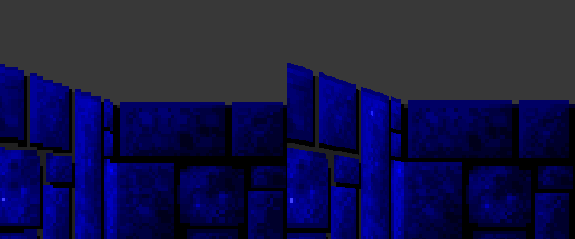

# The hi-res renderer

In a window the 3D view is redrawn at 4× (`--hires N`, 1–6) and, with the full
view size, widened to 16:9: 1704×800 instead of 320×200 stretched. Walls,
doors, actors, objects and the weapon are drawn straight from the game's own
64×64 art at the output resolution. Everything else (game logic, the HUD,
menus, the fizzle, the damage flash) is still the original code.
**F10** cycles widescreen → original → hi-res 4:3; `--widescreen 21:9` (or
`off`) picks the shape.



*The same frame: the original's columns enlarged 4× (left), and redrawn at 4×
(right). The wall's top edge is a staircase in one and a line in the other.*

Code: [`src/hires.c`](../src/hires.c), the finder in
[`tools/lift.py`](../tools/lift.py) `find_renderer()`, the scaler interpreter in
[`src/machine.c`](../src/machine.c) `run_generated()`.

## Why ask the game rather than replace it

A source port would re-implement the raycaster. This keeps the 1992 one. The
game casts its rays, picks its textures, opens its doors and slides its push
walls exactly as it always did; the renderer only listens to the answers and
draws them again at a higher resolution. So every quirk of the original
(which column of a door texture shows, where a push wall is mid-slide) is
right by construction, and the remaster cannot desync the game: it never
writes to it.

## What it listens to

`tools/lift.py` wraps hooks around lifted functions. Each hook calls the
original unchanged and reads DGROUP variables around it. Every address is
read out of this executable's code at lift time, never written down:

```
  renderer: yint=D9A2 xint=D9A6 pixx=D9B2 wallheight=504A postseg=D85A postoff=D858
            sl_seg=DDED sl_cmd=DDEB sl_x=DDF1 sl_w=DDEF bufofs=52D4
  widescreen: pixelangle=960E midangle=D9C8 player=95BC p_angle=002A p_x=0010 p_y=0014 focal=989A
```

| Hook | Found as | What it captures |
|---|---|---|
| raycaster | the one function whose branch opcodes the code patches (`mov byte cs:[...]`) | its six far callees are the Hit routines |
| `hit` ×6 | those callees | per view column: the texture page and column (`postsource`, a far pointer), `wallheight[pixx]`, and the low words of `yintercept`/`xintercept` for the sub-texel position |
| `wall` | the Hit routine's near callee that writes the Map Mask (ScalePost) | tags the wall pixels it writes (`g_draw_tag`) |
| `clear` | ThreeDRefresh's callee just before WallRefresh | tags the floor and ceiling fill, whose colours are read back from it |
| `sline` | the routine that stores `0xCB` (`retf`) and far-calls through memory: the sprite line scaler | per sprite column run: the shape's segment, its post list, the screen column and width |
| `shape` | the line scaler's caller under DrawScaleds | the sprite's height (wallheight units, 4 per pixel) |
| `simple` | its other caller | the weapon's height (pixels); always drawn on top |
| `side` | DrawScaleds | after it returns: the widescreen side passes |

ThreeDRefresh is WallRefresh's only caller, and WallRefresh is the
raycaster's, so the call graph fixes the rest.

## The compiled scalers

Wolf3D does not scale a wall or sprite column with a loop. At start-up it
writes one routine per on-screen height: a straight run of `mov al,[si+n]` /
`mov es:[di+m],al` pairs ending in `retf`. A column is drawn by far-calling the
routine for its height. For a sprite post, the line scaler patches a `retf`
over the post's end, calls into the middle, and puts the byte back.

None of that code exists in the executable, so nothing can be lifted for it. The
first run showed it: every wall and sprite column was a dispatch miss into the
heap.

```
[miss] call far 5259:0104 (image 51594)
8A 44 00 26 88 85 20 08 8A 44 01 26 88 85 70 08 26 88 85 C0 08 8A 44 02 26 88 85 10 09 ...
```

`run_generated()` interprets it instead: a far call with no lifted target,
landing outside the load image, is run from guest memory as it stands at that
moment (the patched `retf` included). It accepts only the three forms the
generator emits (`mov al,[si+d]`, `mov es:[di+d],al`, `retf`), so anything
else is still reported as a miss. `WOLF_MISSDUMP=1` prints the bytes at a miss.
The renderer doesn't need the scalers' output: it reads the same inputs one
level up.

## Composing a frame

At each page flip (the CRTC start address moves), the columns and sprite
runs captured since the last flip become the frame's. When the host presents,
`hires_compose()`:

1. enlarges the VGA picture (`--hires N`), so the HUD, borders and anything
   the game drew over the view stay pixel-exact;
2. finds the 3D view from pixel ownership: who wrote each VGA byte
   (`vga_owner()`, set from `g_draw_tag`);
3. fills the view's floor and ceiling with the colours the game cleared to;
4. draws walls column by column at the output resolution. Each output column
   lies between two of the game's; where both show the same texture page the
   texture coordinate and height are interpolated, at an edge the nearer one
   wins. The game's own column choice is the clamp, so the sub-texel fraction
   never reads into the next column in memory;
5. fits each sprite back from its captured columns: which texel column every
   screen column showed pins the sprite's centre to a fraction of a pixel.
   Then it draws the sprite from its own posts, hidden where the hi-res wall in
   that output column is nearer, as the game hides it per column.

Pixels the game drew that are not walls, floor or sprites (text over the
view, the fizzle fade, the damage flash) stay on top.

## Widescreen

The game casts the columns of its view, and a 16:9 view needs rays beyond
both edges. It gets them from the game itself. Right after DrawScaleds,
WallRefresh and DrawScaleds run twice more, with the player turned left and
then right about the eye, and the hooks capture those passes like the real
frame. The passes must leave no trace:

- all of guest memory and the registers are restored after each pass;
- video memory takes no writes (`vga_hold`);
- no interrupt runs and no time passes (`g_tick_hold`).

The conformance harness checks that the 4:3 middle of a widescreen frame is
identical to the 4:3 frame, and a player track with widescreen on matches
one with it off, position for position.

WallRefresh derives the eye from `player->x/y/angle` (the eye sits
`focallength` behind the player). So a pass turns the angle and moves the
player round the eye by the same amount, and the eye stays put. The turn is
whole degrees, just under the view's full width, so the side strips overlap
the real view by a degree and are cast near the turned views' edges.

Widescreen needs the view at its full width (320 columns: the largest size in
Change View). At smaller sizes the view keeps its border and the frame stays
4:3 in the middle of the wide one. Steam's CONFIG ships size 19 (304 columns),
one short.

## Limits

- **Flat floors and ceilings.** Wolf3D has none textured, so there is nothing
  more to draw there.
- **The weapon is drawn from its own posts at the view's centre**, as
  SimpleScaleShape draws it.
- **Sprite heights come from the game's integer heights**, so a sprite
  steps in size when the game's does. Interpolating between frames would mean
  guessing at motion the game doesn't report.
